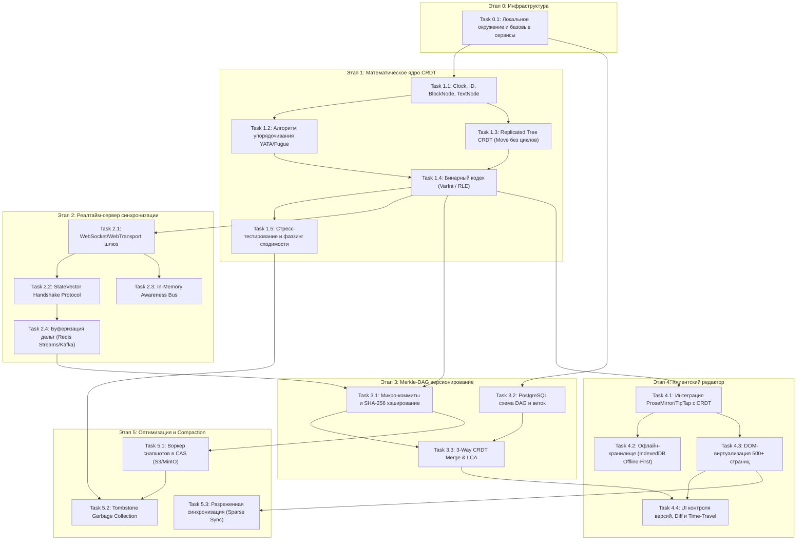

# Roadmap и Реестр Задач Проекта: Merkle-CRDT SyncPro

Данный каталог содержит декомпозицию архитектурной спецификации [antigravity.md](file:///c:/Users/sloobman/syncpro/antigravity.md) на изолированные задачи разработки. Каждая задача размещена в собственной папке со спецификацией `task.md`, включающей контекст, технические требования, контракты данных, граничные случаи и критерии приемки (Definition of Done).

---

## Граф Зависимостей и Этапы Реализации

---

## Реестр Задач

| Модуль | ID | Название задачи | Путь к спецификации | Приоритет |
| :--- | :--- | :--- | :--- | :--- |
| **0. Infra** | `TASK-0.1` | Локальное окружение разработки (PostgreSQL, MinIO, Redis, Docker Compose) | [task.md](file:///c:/Users/sloobman/syncpro/tasks/00-infrastructure-foundation/task-0.1-dev-environment/task.md) | P0 (Блокер) |
| **1. Core CRDT** | `TASK-1.1` | Базовые структуры данных (`Clock`, `ID`, `BlockNode`, `TextNode`, `StateVector`) | [task.md](file:///c:/Users/sloobman/syncpro/tasks/01-crdt-core/task-1.1-clock-id-nodes/task.md) | P0 (Блокер) |
| **1. Core CRDT** | `TASK-1.2` | Алгоритм упорядочивания операций YATA / Fugue при конкурентных вставках | [task.md](file:///c:/Users/sloobman/syncpro/tasks/01-crdt-core/task-1.2-yata-fugue-ordering/task.md) | P0 (Блокер) |
| **1. Core CRDT** | `TASK-1.3` | Replicated Tree CRDT для иерархии блоков и бесконфликтного перемещения (`Move`) | [task.md](file:///c:/Users/sloobman/syncpro/tasks/01-crdt-core/task-1.3-replicated-tree-crdt/task.md) | P0 |
| **1. Core CRDT** | `TASK-1.4` | Высокопроизводительный бинарный кодек дельт (VarInt / RLE) | [task.md](file:///c:/Users/sloobman/syncpro/tasks/01-crdt-core/task-1.4-binary-codec-varint-rle/task.md) | P0 |
| **1. Core CRDT** | `TASK-1.5` | Фреймворк стресс-тестирования сходимости (Fuzz testing на 10k+ операций) | [task.md](file:///c:/Users/sloobman/syncpro/tasks/01-crdt-core/task-1.5-convergence-fuzz-testing/task.md) | P0 |
| **2. Sync Server** | `TASK-2.1` | WebSocket-шлюз с поддержкой Sticky-маршрутизации комнат по `document_id` | [task.md](file:///c:/Users/sloobman/syncpro/tasks/02-sync-server/task-2.1-ws-gateway-room-router/task.md) | P0 |
| **2. Sync Server** | `TASK-2.2` | Протокол рукопожатия векторов состояний (`StateVector Handshake`) | [task.md](file:///c:/Users/sloobman/syncpro/tasks/02-sync-server/task-2.2-statevector-handshake/task.md) | P0 |
| **2. Sync Server** | `TASK-2.3` | In-memory шина Awareness-событий (курсоры, выделения, presence) | [task.md](file:///c:/Users/sloobman/syncpro/tasks/02-sync-server/task-2.3-inmemory-awareness-bus/task.md) | P1 |
| **2. Sync Server** | `TASK-2.4` | Очередь буферизации дельт (Redis Streams / Kafka) с дебаунсом записи | [task.md](file:///c:/Users/sloobman/syncpro/tasks/02-sync-server/task-2.4-delta-buffering-persistence/task.md) | P1 |
| **3. Merkle DAG** | `TASK-3.1` | Механизм микро-коммитов и генерации SHA-256 Merkle-хешей | [task.md](file:///c:/Users/sloobman/syncpro/tasks/03-merkle-dag-versioning/task-3.1-micro-commits-milestones/task.md) | P0 |
| **3. Merkle DAG** | `TASK-3.2` | Проектирование и миграции схемы PostgreSQL (Documents, Branches, Commits) | [task.md](file:///c:/Users/sloobman/syncpro/tasks/03-merkle-dag-versioning/task-3.2-postgres-dag-schema/task.md) | P0 |
| **3. Merkle DAG** | `TASK-3.3` | Алгоритм 3-стороннего слияния веток (3-Way CRDT Merge на базе LCA) | [task.md](file:///c:/Users/sloobman/syncpro/tasks/03-merkle-dag-versioning/task-3.3-crdt-3way-merge/task.md) | P0 |
| **4. Frontend** | `TASK-4.1` | Интеграция редактора ProseMirror / TipTap с локальным CRDT-состоянием | [task.md](file:///c:/Users/sloobman/syncpro/tasks/04-frontend-editor/task-4.1-prosemirror-crdt-binding/task.md) | P0 |
| **4. Frontend** | `TASK-4.2` | Офлайн-хранилище IndexedDB (Offline-First локальная персистентность) | [task.md](file:///c:/Users/sloobman/syncpro/tasks/04-frontend-editor/task-4.2-indexeddb-offline-storage/task.md) | P1 |
| **4. Frontend** | `TASK-4.3` | DOM-виртуализация и ленивый рендеринг блоков для 500+ страниц | [task.md](file:///c:/Users/sloobman/syncpro/tasks/04-frontend-editor/task-4.3-dom-virtualization-lazy-rendering/task.md) | P1 |
| **4. Frontend** | `TASK-4.4` | UI контроля версий: дерево веток, Time-Travel скраббер и посимвольный Diff | [task.md](file:///c:/Users/sloobman/syncpro/tasks/04-frontend-editor/task-4.4-version-control-diff-ui/task.md) | P1 |
| **5. Compaction** | `TASK-5.1` | Воркер периодического снапшотирования CRDT-состояний в CAS (S3) | [task.md](file:///c:/Users/sloobman/syncpro/tasks/05-compaction-optimization/task-5.1-s3-snapshot-worker/task.md) | P1 |
| **5. Compaction** | `TASK-5.2` | Сборка мусора надгробий (Tombstone Garbage Collection) | [task.md](file:///c:/Users/sloobman/syncpro/tasks/05-compaction-optimization/task-5.2-tombstone-garbage-collection/task.md) | P2 |
| **5. Compaction** | `TASK-5.3` | Механизм разреженной синхронизации (Sparse Sync) по секциям документа | [task.md](file:///c:/Users/sloobman/syncpro/tasks/05-compaction-optimization/task-5.3-sparse-sync-streaming/task.md) | P2 |
